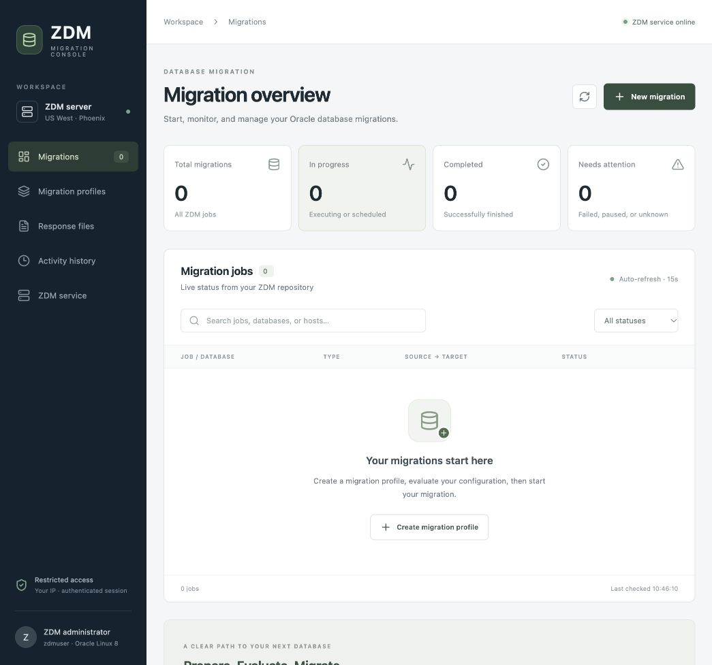
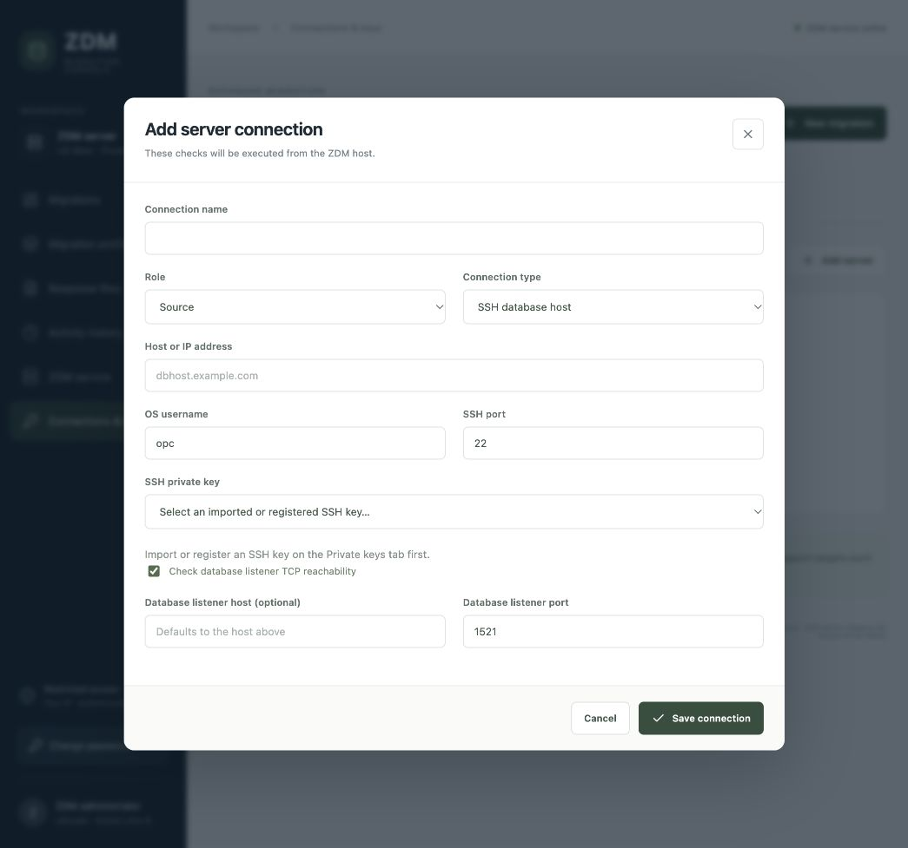
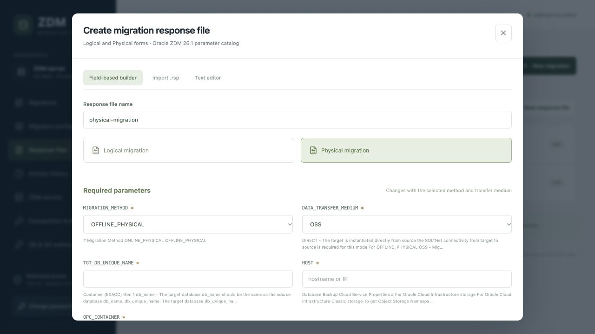
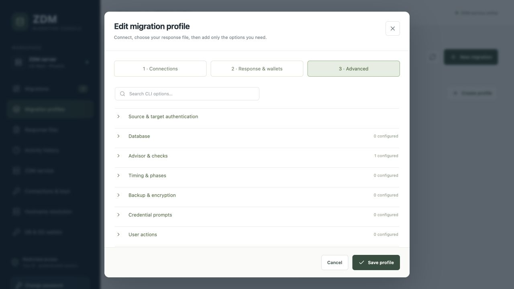

# ZDM GUI — standard self-signed release

An HTTPS console for an existing Oracle Zero Downtime Migration 21.4, 21.5,
or 26.1 installation. Choose either a root-managed system installation or an
owner-only installation as the ZDM owner (`zdmuser`). Both modes generate a
private self-signed server certificate. This package does not install or
upgrade Oracle ZDM.

## Console components

| Component | Purpose |
| --- | --- |
| Migration overview | Shows total, running, completed and attention-required jobs with live ZDM status and quick access to new migrations. |
| Migration profiles | Connects source and target systems, selects a response file, and configures advanced ZDM CLI options before evaluation or execution. |
| Response files | Creates, imports, previews and edits Logical or Physical Oracle ZDM response files using the templates installed with the detected ZDM release. |
| Connections & keys | Stores source/target connection definitions and securely registers the SSH or OCI keys used by ZDM checks and migrations. |
| Activity history | Records submitted console operations, their results and diagnostic output for review. |
| ZDM service | Displays the installed ZDM version, service state, paths and repository details reported by the existing service host. |
| Hostname resolution | Tests name resolution from the ZDM host. System installations can manage a protected GUI block in `/etc/hosts`; user installations are read-only. |
| DB & GG wallets | Creates and manages database and GoldenGate wallets referenced by logical migration response files. |
| Users & roles | Provides Viewer, Manager and Administrator access levels, password management and account status controls. |

## Console screenshots

The screenshots below illustrate the main workflow. They contain no passwords,
private keys or active migration credentials.

### Migration overview

Monitor the job inventory and status summary, then create a migration profile.



### Source and target connections

Define the server role, address, operating-system account, SSH key and optional
database-listener reachability check.



### Response-file builder

Build Logical or Physical response files with method-aware required parameters,
or import and edit an existing `.rsp` file.



### Migration profile options

Combine connections and response files, then add only the advanced ZDM options
needed for the migration before evaluation or execution.



## Requirements and defaults

Use an x86-64 host with Oracle ZDM already installed. ZDM 21.4 and 21.5 use
Oracle Linux 7/8 or RHEL 8. ZDM 26.1 additionally supports Oracle Linux 9 and
RHEL 9. Review the matching Oracle installation guide for the detected release.
The installer rejects other ZDM release lines and invalid OS/release pairings.
The GUI uses isolated Python environments and does not replace the OS Python or
ZDM runtime. Package-repository access is required during installation.

| Component | System mode | User mode |
| --- | --- | --- |
| Application | `/opt/zdm-gui` | `~/zdm-gui` |
| Persistent GUI data | `/var/lib/zdm-gui` | `~/.local/share/zdm-gui` |
| Install manifest | system configuration | `~/.config/zdm-gui/install.json` |
| GUI service | system `zdm-gui.service` | optional user `zdm-gui.service` |
| HTTPS endpoint | NGINX on `0.0.0.0:443` | Uvicorn on `127.0.0.1:8443` |
| Allowed clients | `127.0.0.1/32,::1/128` | `127.0.0.1/32,::1/128` |
| ZDM home / base / stage | `/u01/app/zdmhome`, `/u01/app/zdmbase`, `/u01/app/zdmstage` | same |

Create the stage directory before installing if it does not already exist.
Replace `zdmuser` if ZDM runs under another account:

```bash
ZDM_OS_USER=zdmuser
ZDM_STAGE=/u01/app/zdmstage
sudo install -d -o "$ZDM_OS_USER" -g "$(id -gn "$ZDM_OS_USER")" -m 0750 "$ZDM_STAGE"
```

Application and data directories must be dedicated paths and must not overlap
ZDM storage. The stage directory must be writable by the ZDM owner. Choose a
free HTTPS port in user mode if another application already uses `8443`.

## Certificates

The installer creates a 3072-bit RSA self-signed certificate containing the
DNS hostname or IP entered during installation plus loopback IP SANs for SSH
tunnels. Use the exact configured identity in the browser URL. The connection
is encrypted, but the self-signed certificate does not independently verify
the server's identity.

System-mode certificate files are:

- `/etc/pki/tls/certs/zdm-gui.crt`
- `/etc/pki/tls/private/zdm-gui.key`

User-mode certificate files are stored under `~/zdm-gui/tls/` unless a custom
application directory was selected. The private key remains mode `0600`.
Trusting the public certificate on client systems is optional and removes the
browser warning. Use the organization's approved trust process; never copy the
private key to a client.

If an organization-issued private-CA identity is required instead, use the
separate private-CA release and its README. This standard installer does not
import an external certificate chain.

## Install with Sudo privileges

System mode installs root-owned application code and Python environments, runs
the backend as the existing ZDM owner on loopback port `8080`, and exposes HTTPS
through NGINX on port `443`.

```bash
chmod 755 zdm-gui-linux-x86_64.run
sudo ./zdm-gui-linux-x86_64.run
```

Run it from an interactive terminal. The installer prompts for application,
data and ZDM paths; the ZDM operating-system account; certificate name; browser
client IP/CIDR allowlist; host-firewall access; and optional Oracle ZDM service
auto-start. Confirm that ZDM home contains executable `bin/zdmcli` and
`bin/zdmservice`.

The installer displays missing RPM packages and asks before installing them
with `dnf` or `yum`. It creates and enables `zdm-gui.service`,
`zdm-hosts-manager.service`, and NGINX. The backend remains bound to
`127.0.0.1:8080`; NGINX listens on the network and provides encrypted web
access at `https://HOSTNAME`. Replace `HOSTNAME` with the certificate hostname
entered during installation.

Oracle ZDM auto-start is opt-in. Selecting it creates and enables the separate
`zdmservice-autostart.service` unit. The default is No. Declining removes only
that installer-managed unit and does not stop a running ZDM service.

On a new GUI database, a random initial `zdmadmin` password appears once after
successful installation. Store it securely and change it at first sign-in.
Existing GUI accounts, password hashes, profiles and audit history are
preserved when the same data directory is reused.

## User precheck and install

User mode requires Python 3.9+ with venv, SSL and SQLite, plus OpenSSL,
SSH/ssh-keygen, expect and unzip. It never invokes sudo, `dnf`/`yum`, NGINX,
firewall tools or system service changes. The current account must own ZDM home
and must be able to write ZDM base and stage.

On Oracle Linux 8, an administrator can prepare the runtime without replacing
the OS Python:

```bash
sudo dnf module install -y python39
sudo dnf install -y python39-pip openssl openssh-clients expect unzip
```

Oracle Linux 8 AppStream must be enabled and reachable. Do not replace
`/usr/bin/python3` or change the system Python alternatives. See
[Oracle's Python installation guidance](https://yum.oracle.com/oracle-linux-python.html).
If pip later needs to compile a package, ask the administrator to install:

```bash
sudo dnf install -y gcc python39-devel openssl-devel libffi-devel
```

As `zdmuser`, verify the runtime:

```bash
python3.9 - <<'PY'
import sys, ssl, sqlite3, venv, tempfile, subprocess
print("Python:", sys.version.split()[0])
print("SSL:", ssl.OPENSSL_VERSION)
print("SQLite:", sqlite3.sqlite_version)
with tempfile.TemporaryDirectory(prefix="zdm-python-check-") as folder:
    venv.EnvBuilder(with_pip=True).create(folder)
    subprocess.run([folder + "/bin/python", "-m", "pip", "--version"], check=True)
print("Python prerequisites passed.")
PY
```

Run a no-write precheck, then install as the ZDM owner without sudo:

```bash
chmod 755 zdm-gui-linux-x86_64.run
./zdm-gui-linux-x86_64.run --user --yes --check
./zdm-gui-linux-x86_64.run --user
```

`Checks passed. No changes made.` confirms the local prerequisite and path
checks; it does not test package downloads, external firewall reachability or
client certificate trust. Running the installer as any non-root account also
selects user mode automatically.

The default binding is loopback. For direct access select `0.0.0.0` and set the
browser-client allowlist to actual source IPs/CIDRs. `0.0.0.0` is a listen
address, not a browser URL or certificate identity.

## User installer options

| Option | Meaning / default |
| --- | --- |
| `--user` | Select owner-only mode; supply it first. A non-root caller selects user mode automatically. |
| `--yes` | Accept defaults for unanswered prompts; explicit arguments override defaults. |
| `--check` | Validate prerequisites and paths without installing. |
| `--app-dir PATH` | Application directory; default `~/zdm-gui`. |
| `--data-dir PATH` | Persistent data; default `~/.local/share/zdm-gui`. |
| `--zdm-home PATH` | Existing owner-matching ZDM home; default `/u01/app/zdmhome`. |
| `--zdm-base PATH` | Existing writable ZDM base; default `/u01/app/zdmbase`. |
| `--zdm-stage PATH` | Existing writable stage; default `/u01/app/zdmstage`. |
| `--tls-name NAME` | Browser DNS hostname or IP; default server FQDN. |
| `--bind ADDRESS` | `127.0.0.1` or `0.0.0.0`; default loopback. |
| `--port NUMBER` | HTTPS port; default `8443`, valid range `1024`–`65535`. |
| `--allowed-clients CIDRS` | Comma-separated IPs/CIDRs; default loopback only. |
| `--service auto` | Default: user systemd service if available, otherwise manual. |
| `--service manual` | Use start/stop scripts; no automatic startup after reboot. |
| `--service user` | Require a working user systemd manager and enable the GUI unit. |
| `--no-start` | Install without starting the GUI immediately. |
| `--help` / `-h` | Show installer help. |

The root-managed system installer is interactive and does not accept these
user-mode options.

## Command help

Display general installer help, detailed user-mode options, or uninstaller
options without making changes:

```bash
./zdm-gui-linux-x86_64.run --help
./zdm-gui-linux-x86_64.run --user --help
./zdm-gui-uninstall.run --help
```

The first command describes system and user installation modes. The second
lists every user installer argument and default. The third lists system/user
uninstall, dry-run, path and ZDM auto-start options.

## Firewall, access and client trust

The GUI allowlist and network firewalls must both permit the browser client's
source IP. In system mode the installer can offer to open HTTPS in the active
firewalld zone. In user mode an administrator must allow the selected port.
OCI security lists or NSGs must also allow the port; the installer cannot
change OCI network rules.

For a loopback-only user installation, create a tunnel from the client:

```bash
ssh -N -L 18443:127.0.0.1:8443 SSH_USER@ZDM_HOST
```

Open `https://127.0.0.1:18443`. For a loopback-only system installation, tunnel
the NGINX listener instead:

```bash
ssh -N -L 18443:127.0.0.1:443 SSH_USER@ZDM_HOST
```

The generated certificate includes loopback SANs. Accept the self-signed
certificate warning or import the public certificate using the approved client
trust process. For direct system-mode access, open `https://HOSTNAME`. For
direct user-mode access, open `https://HOSTNAME:8443` unless a different port
was selected. In both cases, replace `HOSTNAME` with the certificate hostname
entered during installation. Do not use `0.0.0.0` as the browser URL.

## Startup, logs and access after reboot

For system mode:

```bash
sudo systemctl status zdm-gui zdm-hosts-manager
sudo journalctl -u zdm-gui -n 100 --no-pager
sudo systemctl restart zdm-gui
```

`systemctl status zdm-gui zdm-hosts-manager` checks both GUI components:

- `zdm-gui` runs the web application as the configured ZDM operating-system
  account. A healthy service reports `Loaded: loaded`, `enabled`, and
  `Active: active (running)`.
- `zdm-hosts-manager` is the root helper used only for GUI-managed hostname
  entries. It should also report `active (running)`. User-mode installations do
  not use this system helper and treat `/etc/hosts` as read-only.

`journalctl -u zdm-gui -n 100 --no-pager` prints the latest 100 GUI log lines
without opening the interactive pager. Use it after a failed start, an HTTP 5xx
response, or an unexpected restart. Add `-f` to follow new messages live:

```bash
sudo journalctl -u zdm-gui -f
```

`systemctl restart zdm-gui` stops and starts only the GUI backend; it does not
restart Oracle ZDM or NGINX. Wait for queued/running migration operations before
restarting. Afterward verify all web components and the HTTPS configuration:

```bash
sudo systemctl status zdm-gui zdm-hosts-manager nginx
sudo nginx -t
curl -kI https://HOSTNAME/
```

Replace `HOSTNAME` with the configured server hostname. If the helper itself
needs restarting, do so explicitly with
`sudo systemctl restart zdm-hosts-manager`.

The system GUI and NGINX are enabled at boot. If Oracle ZDM auto-start was
selected, check it separately with:

```bash
sudo systemctl status zdmservice-autostart.service
```

For user mode, log in as the installation owner and run without sudo:

```bash
~/zdm-gui/bin/zdm-gui-start
~/zdm-gui/bin/zdm-gui-status
~/zdm-gui/bin/zdm-gui-stop
```

Replace `~/zdm-gui` if a custom application directory was selected. Manual
mode must be started again after reboot and may be terminated at logout by the
host's session policy. Its log is `~/zdm-gui/logs/gui.log`:

```bash
tail -50 ~/zdm-gui/logs/gui.log
```

For a user-service installation:

```bash
systemctl --user status zdm-gui.service
journalctl --user -u zdm-gui.service -n 50 --no-pager
```

Automatic user-service startup at boot and survival after logout require a
working user systemd manager and, where appropriate, administrator-enabled
lingering:

```bash
sudo loginctl enable-linger zdmuser
```

This controls GUI startup only. Oracle ZDM service startup remains separately
managed.

## Upgrade and preserved data

Rerun the installer in the same mode and select the same application, data and
ZDM paths. System mode is interactive. For user mode, repeat any non-default
network, service or path arguments because omitted options use their defaults.

Queued or running GUI operations block upgrade and uninstall. Existing accounts,
password hashes, profiles and audit history are preserved when the same data
directory is used. The installer saves protected snapshots before replacing
existing application code: system backups are under `/var/backups/zdm-gui/` and
user backups are under `~/.local/state/zdm-gui/backups/`.

The generated certificate is installer-managed. Record the selected certificate
identity and network settings before upgrade. Back up GUI data and ZDM
credential/key storage using the organization's secure backup process.

## Uninstall

Preview the detected paths before removing a system installation:

```bash
sudo ./zdm-gui-uninstall.run --dry-run
sudo ./zdm-gui-uninstall.run
```

The uninstaller asks you to type `UNINSTALL`. Use `--app-dir PATH` and
`--data-dir PATH` if automatic detection is incorrect. `--yes` supports
unattended execution after reviewing the dry run.

It asks about Oracle ZDM auto-start only when
`zdmservice-autostart.service` is installed. The default is to preserve it.
`--remove-zdm-autostart` explicitly disables and removes the boot unit without
stopping the currently running Oracle ZDM service. `--yes` alone preserves it.

### Uninstall the GUI as zdmuser

For a user installation, log in as `zdmuser` (or the account that installed the
GUI) and run without sudo:

```bash
./zdm-gui-uninstall.run --user --dry-run
./zdm-gui-uninstall.run --user
```

Use `--app-dir PATH` if a custom location has no manifest. User uninstall acts
only on user-owned files and user services. Its optional auto-start removal can
remove only an installed **user** ZDM auto-start unit; it cannot change system
units.

Both modes preserve GUI data, Oracle ZDM software, ZDM home/base/stage,
migration files, managed `/etc/hosts` entries and backups, shared packages,
firewall rules and SELinux settings. Configuration and TLS material are backed
up under `/var/backups/zdm-gui-uninstall.*` in system mode or
`~/.local/state/zdm-gui/uninstall-backups/` in user mode. Remove obsolete
firewall and client trust settings separately after review.

## Security and validation scope

The release preserves the GUI's authentication, password-change requirement,
roles and source-IP allowlist. User mode treats `/etc/hosts` as read-only;
hostname-resolution checks remain available. System mode uses the separate
root helper for managed host entries.

Self-signed TLS protects transport but does not provide CA-backed server
identity. The release does not add MFA, login throttling, CRL or OCSP checking.
Restrict network access and protect migration response files, logs, GUI data,
backups and ZDM credentials according to the organization's requirements.
